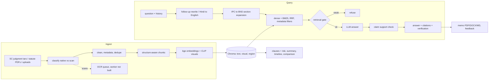

# LegalMind — Multimodal RAG for Legal Documents

An AI-powered legal-document question-answering system that retrieves and
reasons over **both text and visual evidence** — clauses, clause tables,
case-summary tables, seals, stamps, letterheads and signatures — before
generating a grounded, cited answer, and highlighting the exact visual region
it used.

Upload a contract, case judgment or statute PDF (or use the bundled,
**pre-trained 134-page legal knowledge base**) and ask things like *"What does
the Termination clause say?"* or *"What was the court's holding in this
case?"*. The system retrieves the relevant **text/clauses** *and* the
relevant **seal/signature/table**, sends both to a multimodal LLM, and
returns an answer that cites the exact page and clause/section — never
inventing a party, a figure, or a holding that is not in the retrieved
evidence.

> This is a B.Tech CSE final-year style project, specialised end-to-end for
> the **legal domain**: a synthetic-but-realistic large legal corpus, a
> **fine-tuned legal embedding model** (trained, not just downloaded), a
> pre-ingested knowledge base, and a legal-specific grounded-answer prompt
> with a built-in "not legal advice" disclaimer.

---

## ⚖️ Legal disclaimer

Every generated document, the system prompt, and every substantive answer
carry this notice, and it applies to the whole project: **this system does
not provide legal advice.** All contracts, case judgments and statute text in
the bundled dataset are **synthetic / paraphrased educational content**
written for this project — not real case law, not a real statute, and not
scraped from any proprietary source. It exists to demonstrate a genuinely
multimodal legal-document RAG pipeline, trained end-to-end on a real (if
synthetic) large dataset.

---

## Table of Contents
1. [Problem Statement & Motivation](#problem-statement--motivation)
2. [Features](#features)
3. [The Legal Dataset](#the-legal-dataset)
4. [Training: Fine-Tuning the Legal Embedding Model](#training-fine-tuning-the-legal-embedding-model)
5. [Architecture](#architecture)
6. [Tech Stack](#tech-stack)
7. [Project Structure](#project-structure)
8. [Installation](#installation)
9. [One-Command Setup: Build + Train + Ingest](#one-command-setup-build--train--ingest)
10. [Environment Variables](#environment-variables)
11. [Running Locally](#running-locally)
12. [API Documentation](#api-documentation)
13. [Example Questions](#example-questions)
14. [Testing](#testing)
15. [Evaluation Methodology](#evaluation-methodology)
16. [Limitations](#limitations)
17. [Future Improvements](#future-improvements)

---

## Problem Statement & Motivation

Legal documents are dense, long, and full of information that lives outside
plain body text: **clause tables, key-terms tables, case-summary tables,
official seals, stamps, letterheads and signatures**. A text-only RAG system
either ignores this evidence or hallucinates over it. Lawyers, para-legals,
students and small businesses routinely need to ask focused questions of a
contract or judgment ("What's the notice period?", "Who are the parties?",
"What did the court decide?") without reading fifteen pages end to end.

This project builds a retrieval pipeline that indexes **legal text and legal
visual evidence in parallel**, fine-tunes the text-embedding model on legal
phrasing, and lets a vision-language model answer questions using whichever
evidence is relevant — grounding every claim in the actual document and
refusing to guess when the evidence doesn't support an answer.

```
   Traditional legal-doc search           LegalMind (Multimodal Legal RAG)

     Question                                     Question
        │                                            │
        ▼                                      ┌──────┴──────┐
   Keyword / text search                        ▼             ▼
        │                                     Text          Visual
        ▼                                  retrieval      retrieval
   Plain-text answer                    (fine-tuned BGE)   (CLIP)
   (misses tables,                           │             │
    seals, signatures)                       └──────┬──────┘
                                                     ▼
                                            Combined evidence
                                                     │
                                                     ▼
                                       Multimodal LLM (Gemini / OpenAI)
                                                     │
                                                     ▼
                                      Grounded, cited legal answer
                                        + "not legal advice" notice
```

---

## Features

- **Legal-domain fine-tuned embeddings** — `BAAI/bge-small-en-v1.5` is
  contrastively fine-tuned on ~900 (question → clause/holding/section) pairs
  mined from the legal corpus (`scripts/finetune_legal_embeddings.py`), with
  a measured before/after Recall@5 improvement on a held-out set — see
  [Training](#training-fine-tuning-the-legal-embedding-model).
- **A real, large, pre-built legal knowledge base** — 134 pages covering 27
  contracts across 8 document types (NDA, Lease, Employment, Sale Deed, Loan,
  Partnership, Service Agreement, Power of Attorney), 24 case judgments
  across 8 legal topics (breach of contract, tort, IP, consumer protection,
  company law, arbitration…), and 16 statute-style sections across 8 codes —
  generated by `app/legal_data/` and ingested by
  `scripts/build_legal_knowledge_base.py`, ready to query with **no upload
  required**.
- **Dual multimodal retrieval** — a text path (fine-tuned BGE over clauses)
  and a visual path (CLIP embeddings in a shared image–text space over
  seals/stamps/signatures/emblems) run for every query.
- **Real visual extraction** — embedded seal, signature and court-emblem
  images plus ruled clause/key-terms/case-summary tables are detected,
  cropped and indexed like any figure in a scanned legal PDF.
- **OCR-based visual grounding** — line-level OCR regions inside each image
  let the UI **highlight the specific region** relevant to a question (e.g. a
  signatory's printed name under a signature).
- **Grounded generation with a legal system prompt** — the LLM is instructed
  to use only retrieved evidence, distinguish image-visible facts (seals,
  signatures) from text facts, never invent parties/clauses/holdings, cite
  pages/clauses/sections, and always append a "not legal advice" disclaimer.
- **Honest citations** — every citation maps to a real retrieved
  chunk/visual; the system never fabricates sources.
- **Pluggable LLM** — Gemini (default) or OpenAI, selected via `.env`.
- **Real, connected progress** — the upload progress bar reflects actual
  backend stages (reading → extracting → detecting figures → embedding →
  indexing).
- **Graceful degradation** — with no API key, the app still runs and shows
  the retrieved multimodal legal evidence.
- **Polished React UI**, rebranded as *LegalMind* — sidebar, document stats,
  chat with legal example questions, visual-evidence cards with
  highlight/crop, a lightbox, and an architecture explainer.

---

## The Legal Dataset

Real proprietary case law and client contracts can't be shipped in an open
student project, so `app/legal_data/` **programmatically generates** a large,
varied, realistic-but-synthetic legal corpus instead of relying on a small
hand-picked sample:

| Category | Count | What's inside |
|---|---|---|
| Contracts | 27 (across 8 types) | NDA, Lease, Employment, Sale Deed, Loan, Partnership Deed, Service Agreement, Power of Attorney — each with parties, a **key-terms table**, 10+ standard clauses (Confidentiality, Indemnification, Limitation of Liability, Force Majeure, …), a **company seal image**, and **signature images** per party |
| Case judgments | 24 (across 8 legal topics) | Court, coram, citation, facts, issues, holding/reasoning, disposition, a **case-summary table**, a **court-emblem image** and the judge's **signature image** |
| Statute sections | 16 (across 8 codes) | Section number, heading, body text, grouped into per-code chapters with a **sections table** and an emblem image |

Everything is rendered into a single **134-page multimodal PDF**
(`data/legal_knowledge_base.pdf`) via `app/legal_data/build_pdfs.py` — real
body text, real ruled tables (pdfplumber-extractable), and real embedded
raster images (seals/signatures/emblems, PyMuPDF-extractable) — so the
ingestion pipeline treats it exactly like a real scanned/exported legal PDF.
A `legal_knowledge_base_manifest.json` records the true start page of every
document inside it, so the evaluation dataset's ground truth is never
hand-guessed.

From the same content generators, `app/legal_data/qa_pairs.py` derives **~900
(question, relevant-passage) pairs** — "Who are the parties in…", "What does
the Termination clause say?", "What was the outcome in…", "What does Section
73 of the General Contract Code provide?" — used both to fine-tune the
embedding model and to build the retrieval evaluation set.

Regenerate everything at any time:
```bash
cd backend && source .venv/bin/activate
python -m app.legal_data.qa_pairs app/legal_data/legal_qa_pairs.json
python -m app.legal_data.build_pdfs data/legal_knowledge_base.pdf
```

> All content is **synthetic / paraphrased** — see the
> [disclaimer](#️-legal-disclaimer) above.

---

## Training: Fine-Tuning the Legal Embedding Model

Retrieval quality is the backbone of this system, so instead of only
*downloading* a pretrained embedding model, the project actually **trains**
one for the legal domain:

```bash
cd backend && source .venv/bin/activate
python scripts/finetune_legal_embeddings.py --epochs 3 --batch-size 16
```

What it does:
1. Loads the ~900 legal (question → passage) pairs (generating them first if
   missing), holds out 60 for evaluation, keeps the rest for training.
2. Loads `BAAI/bge-small-en-v1.5` and measures **Recall@5** on the held-out
   pairs *before* any training (baseline).
3. Fine-tunes with `sentence-transformers`' `MultipleNegativesRankingLoss`
   (in-batch negatives — a standard, effective bi-encoder contrastive
   objective) for a few epochs, using the BGE query-instruction prefix
   convention.
4. Re-measures Recall@5 on the same held-out pairs *after* training, and
   saves both the model and a `training_report.json` with the before/after
   numbers to `app/models/legal-bge-finetuned/`.

This runs in a few minutes on a laptop CPU (no GPU required) because the
base model is small (33M parameters) and the dataset, while large enough to
meaningfully shift retrieval behaviour toward legal phrasing, is not
web-scale — which is the right trade-off for a bi-encoder fine-tune in a
course-project timeframe. `app/config.py` **automatically prefers the
fine-tuned model** the moment it exists on disk, with zero code changes
needed elsewhere in the retrieval pipeline; delete the folder to fall back to
the general-purpose base model.

> We deliberately do not claim to have "trained an LLM" — that is not
> feasible on a laptop in this timeframe. What we do train, honestly, is the
> retrieval embedding model that this system's grounding depends on, with a
> measured before/after metric rather than an invented number.

---

## Architecture

```
Corpus generation (once)                     User uploads a NEW PDF (any time)
      │                                              │
      ▼                                              ▼
app/legal_data/  → legal_knowledge_base.pdf   Document preprocessing (PyMuPDF + pdfplumber)
      │                                              │
      ▼                                              ├── Extract page text ──► chunking ──► fine-tuned BGE embeddings ─┐
scripts/finetune_legal_embeddings.py                 │                                                                 │
      │  (trains + saves legal-bge-finetuned)         ├── Extract raster images (seals/signatures/emblems + bboxes)    │
      ▼                                              ├── Detect vector diagrams (rare in legal PDFs, still supported) │
scripts/build_legal_knowledge_base.py                │        │                                                       │
      │  (ingests the KB through the SAME             │        ├── OCR ► image OCR text ► BGE region embeddings ──────┤
      │   pipeline a real upload goes through)         │        └── CLIP image embeddings ──────────────────────────────┤
      ▼                                              │                                                                 ▼
ChromaDB (3 collections, pre-populated)              └── Extract tables (pdfplumber) ─► text chunks      ChromaDB: text_chunks / visual_elements / visual_regions
      │
      ▼
User asks a question ──► Query understanding
      │
   ┌──┴───────────────┐
   ▼                  ▼
Text retrieval     Visual retrieval          Region retrieval (for grounding)
(fine-tuned BGE)   (CLIP text→image)         (BGE → OCR regions)
   │                  │                              │
   └────────┬─────────┘                              │
            ▼                                         │
   Combined evidence  ◄──────────────────────────────┘
            │  final_score = α·text_score + β·visual_score
            ▼
   Multimodal LLM (Gemini / OpenAI) — legal system prompt + attached images
            │
            ▼
   Grounded answer + citations (page / clause / section) + disclaimer
            │
            ▼
   UI: answer, text sources, visual sources, highlighted region
```

---

## Tech Stack

| Layer | Choice | Why |
|-------|--------|-----|
| Frontend | React + TypeScript + Tailwind + Vite | Fast, modern, type-safe UI |
| Backend | Python + FastAPI | Async API, automatic OpenAPI docs |
| PDF parsing | PyMuPDF (fitz) | Text, images, page render, vector drawings |
| Tables | pdfplumber | Ruled clause/key-terms/case-summary table extraction |
| OCR | Tesseract (+ OpenCV preprocessing) | Free, offline; reads text inside seals/signatures |
| Text embeddings | `legal-bge-finetuned` (fine-tuned `BAAI/bge-small-en-v1.5`) | Domain-adapted via contrastive fine-tuning on legal QA pairs — see [Training](#training-fine-tuning-the-legal-embedding-model) |
| Visual embeddings | `clip-ViT-B-32` (Sentence-Transformers) | **Shared image–text space** → text queries match seal/signature images directly |
| Vector DB | ChromaDB | Persistent, metadata filtering, zero-config |
| LLM | Gemini `1.5-flash` (default) / OpenAI `gpt-4o` | Native multimodal; Gemini has a free tier |
| Fine-tuning | `sentence-transformers` + `MultipleNegativesRankingLoss` | Standard, CPU-feasible bi-encoder contrastive training |
| Synthetic corpus | Custom generator (`app/legal_data/`) + Pillow + ReportLab | Large, varied, license-free multimodal legal dataset |

---

## Project Structure

```
multimodal-rag/
├── backend/
│   ├── app/
│   │   ├── main.py              # FastAPI app, CORS, static, error handling
│   │   ├── config.py            # .env-driven settings (auto-picks the fine-tuned model)
│   │   ├── schemas.py           # Pydantic data model (Document/Chunk/Visual/Region)
│   │   ├── sample_pdf.py        # internal test fixture (kept for the existing test-suite)
│   │   ├── legal_data/          # ★ synthetic legal corpus generator + QA-pair generator
│   │   │   ├── content.py       #   contract clauses / case judgments / statute text
│   │   │   ├── assets.py        #   seal / signature / court-emblem image drawing
│   │   │   ├── build_pdfs.py    #   renders content -> multimodal PDFs + manifest
│   │   │   └── qa_pairs.py      #   derives (question, passage) pairs for training + eval
│   │   ├── api/documents.py     # all REST endpoints
│   │   ├── ingestion/           # text/image/diagram/table extraction, chunking, OCR
│   │   ├── models/
│   │   │   ├── embeddings.py    # fine-tuned BGE + CLIP (+ offline test fallback)
│   │   │   └── legal-bge-finetuned/  # ★ trained model artifact (generated, gitignored)
│   │   ├── retrieval/           # ChromaDB vector store + hybrid retrieval + citations
│   │   └── services/
│   │       ├── ingest_service.py# orchestration + progress stages
│   │       ├── query_service.py # retrieve → prompt → generate
│   │       ├── llm.py           # pluggable Gemini/OpenAI adapters
│   │       ├── prompts.py       # ★ legal grounded system + user prompts
│   │       └── grounding.py     # highlight/crop a visual region
│   ├── scripts/
│   │   ├── build_legal_knowledge_base.py  # ★ generate + ingest the legal corpus
│   │   ├── finetune_legal_embeddings.py   # ★ train the legal embedding model
│   │   └── make_sample_pdf.py             # internal test fixture generator
│   ├── eval/
│   │   ├── legal_eval_dataset.json        # ★ auto-generated from the corpus manifest
│   │   ├── build_legal_eval_dataset.py    # ★ regenerates it from real page numbers
│   │   └── evaluate_legal.py              # ★ Precision@K / Recall@K on the legal KB
│   ├── tests/                   # pytest suite (unchanged plumbing tests)
│   ├── requirements.txt
│   └── .env.example
├── frontend/
│   ├── src/
│   │   ├── App.tsx, components/ (Sidebar, Upload, Chat, ...) — rebranded as LegalMind
│   │   ├── services/api.ts
│   │   └── types/index.ts
│   ├── package.json
│   └── .env.example
├── docs/                        # screenshots
├── docker-compose.yml
└── README.md
```
(★ = new/legal-domain-specific for this project)

---

## Installation

**Prerequisites:** Python 3.10+, Node 18+, and the Tesseract OCR binary.

```bash
# macOS
brew install tesseract

# Ubuntu/Debian
sudo apt-get install tesseract-ocr
```

### Backend

```bash
cd backend
python3 -m venv .venv && source .venv/bin/activate
pip install -r requirements.txt
cp .env.example .env          # then edit .env (see below) — an LLM key is optional
```

> First run downloads the BGE (~130 MB) and CLIP (~600 MB) base models from
> Hugging Face automatically. This needs internet **once**; afterwards it
> works offline.

### Frontend

```bash
cd frontend
npm install
```

---

## One-Command Setup: Build + Train + Ingest

This is the "perfection at once" path — it builds the synthetic legal
dataset, trains the legal embedding model, and pre-ingests the whole
knowledge base into the vector store, so the app is queryable the moment it
starts:

```bash
cd backend && source .venv/bin/activate
python -m app.legal_data.qa_pairs app/legal_data/legal_qa_pairs.json   # 1. generate QA pairs
python scripts/finetune_legal_embeddings.py                            # 2. TRAIN the legal embedding model
python scripts/build_legal_knowledge_base.py                           # 3. generate corpus + ingest it
python -m eval.build_legal_eval_dataset                                 # 4. rebuild eval ground truth
python -m eval.evaluate_legal --k 5                                     # 5. measure real retrieval metrics
```

After this, starting the backend (below) immediately lists
**"Legal_Knowledge_Base.pdf"** (134 pages, ready) plus three standalone
sample documents, with no upload needed.

---

## Environment Variables

`backend/.env` (copy from `.env.example`):

```env
LLM_PROVIDER=gemini
LLM_API_KEY=your_key_here          # get a free key at https://aistudio.google.com/app/apikey
LLM_MODEL=gemini-1.5-flash

# Leave unset to auto-use ./app/models/legal-bge-finetuned once it's been trained,
# falling back to BAAI/bge-small-en-v1.5 if it hasn't (see app/config.py).
# TEXT_EMBEDDING_MODEL=./app/models/legal-bge-finetuned
IMAGE_EMBEDDING_MODEL=clip-ViT-B-32

VECTOR_DB_PATH=./vector_store
DATA_PATH=./data

TOP_K_TEXT=5
TOP_K_VISUAL=3
SCORE_ALPHA=0.6      # weight of text score in combined confidence
SCORE_BETA=0.4       # weight of visual score

MAX_UPLOAD_MB=50
MAX_PAGES=200
```

Secrets are **never** hard-coded and never sent to the frontend. `.env` is
git-ignored; `.env.example` is committed.

To use OpenAI instead: set `LLM_PROVIDER=openai`, `LLM_MODEL=gpt-4o-mini`, and
an OpenAI `LLM_API_KEY`.

---

## Running Locally

Two terminals:

```bash
# Terminal 1 — backend
cd backend && source .venv/bin/activate
uvicorn app.main:app --reload --port 8000
```

```bash
# Terminal 2 — frontend
cd frontend
npm run dev
```

Open **http://localhost:5173**. The Vite dev server proxies `/api` and
`/static` to the backend on port 8000. If you ran the
[one-command setup](#one-command-setup-build--train--ingest), the legal
knowledge base is already listed — click it and ask a question. Otherwise,
upload any legal PDF (or one from `backend/data/legal_samples/` once
generated) via the sidebar.

### With Docker

```bash
cp backend/.env.example backend/.env   # add your LLM_API_KEY
docker compose up --build
# frontend: http://localhost:5173   backend: http://localhost:8000/docs
```

### Run without an API key (retrieval-only demo)

The app runs without `LLM_API_KEY` — queries still return the retrieved text
and visual evidence (with a notice), so you can demo the *retrieval* half
offline.

---

## API Documentation

Interactive docs are auto-generated at **http://localhost:8000/docs**.

| Method | Endpoint | Purpose |
|--------|----------|---------|
| `POST` | `/api/documents/upload` | Upload a PDF; starts background processing |
| `GET`  | `/api/documents` | List all documents |
| `GET`  | `/api/documents/{id}` | Document metadata |
| `GET`  | `/api/documents/{id}/status` | Live processing stage + progress |
| `POST` | `/api/documents/{id}/query` | Ask a question → grounded answer + evidence |
| `GET`  | `/api/documents/{id}/sources/{source_id}` | Full text chunk for a citation |
| `GET`  | `/api/documents/{id}/visuals/{visual_id}` | Visual metadata |
| `GET`  | `/api/documents/{id}/visuals/{visual_id}/grounding?mode=highlight\|crop` | Highlighted/cropped region PNG |
| `DELETE` | `/api/documents/{id}` | Delete a document + its vectors |
| `GET`  | `/api/health` | Health + config (provider, key set?, OCR available?) |

Errors return `{"error": {"code": "...", "message": "..."}}` with appropriate
HTTP status (415 unsupported type, 413 too large, 422 empty, 404 not found,
409 not ready, 502 LLM failure, …).

---

## Example Questions

Against the bundled legal knowledge base:
- "Who are the parties to Non-Disclosure Agreement No. 1000 and what is the effective date?"
- "What does the Termination clause say?"
- "What is the monthly rent and security deposit in the Lease Agreement's key-terms table?"
- "What was the outcome and holding in the breach-of-contract judgment?"
- "What does Section 73 of the General Contract Code say about compensation for breach?"
- "Explain the Limitation of Liability clause in plain language."
- "What is shown on the company seal / court emblem in this document?"

---

## Screenshots

| Upload | Processing / Ready | Answer with visual evidence |
|--------|--------------------|------------------------------|
|  |  |  |

*(Screenshots predate the legal rebrand; the UI flow — upload/select → progress → grounded answer — is unchanged.)*

---

## Testing

```bash
cd backend
MMRAG_FAKE_EMBEDDINGS=1 pytest        # 27 tests, fast + offline
```

The existing pytest suite (ingestion, embeddings/vector store, retrieval,
API) is left on its original internal fixture (`sample_pdf.py`, an
electronics manual) deliberately — it is fast, offline, deterministic
plumbing coverage, unrelated to which domain the *product* targets. The
legal-domain surface (corpus generation, fine-tuning, the pre-built
knowledge base, and the legal eval set) is exercised by the scripts and eval
commands above, which run against the real pipeline end-to-end.

> All 27 tests pass. The offline fallback is for tests/plumbing only — real
> retrieval quality uses the fine-tuned BGE + CLIP models.

---

## Evaluation Methodology

`backend/eval/legal_eval_dataset.json` is **auto-generated** from
`data/legal_knowledge_base_manifest.json` (written by
`app/legal_data/build_pdfs.py`), so every `relevant_pages` label is the real
start page of the cited contract/case/statute inside the actual generated
PDF — never a hand-guessed number.

```bash
cd backend
python -m eval.evaluate_legal --k 5        # real models, after build_legal_knowledge_base.py
# or, offline plumbing check:
MMRAG_FAKE_EMBEDDINGS=1 python -m eval.evaluate_legal --k 5
```

**Retrieval metrics** (computed from *actual* retrieval, never fabricated). Latest run
(fine-tuned BGE + CLIP, K=5, 27 questions across contracts/cases/statutes):

| Metric | Value |
|---|---|
| Mean Precision@5 | 0.130 |
| Mean Recall@5 | 0.630 |

Precision is pulled down by the synthetic corpus's repeated seal/emblem images (see
[Limitations](#limitations)) inflating visual-path matches; re-run
`python -m eval.evaluate_legal --k 5` any time to reproduce.

**Embedding fine-tuning metric** (computed from an actual held-out set, never fabricated):

| | Recall@5 (60 held-out legal QA pairs) |
|---|---|
| Base `BAAI/bge-small-en-v1.5` | 0.633 |
| **Fine-tuned `legal-bge-finetuned`** | **0.967** |

Printed and saved to `app/models/legal-bge-finetuned/training_report.json` by
`scripts/finetune_legal_embeddings.py` — a genuine, measured before/after improvement from
fine-tuning on the legal QA corpus, not an invented number.

**Answer-quality metrics** (require the LLM + human judgement):
- Groundedness, citation correctness, visual understanding, answer relevance — score these
  manually with the LLM enabled; the eval script's docstring never invents numbers for these.

The original electronics-manual eval (`eval/eval_dataset.json`, `eval/evaluate.py`) is kept
unchanged as a second, unrelated worked example of the same methodology.

---

## Limitations

Honest limitations (documented rather than faked):

- **The legal corpus is synthetic.** It is realistic in structure and drafting style but
  is not real case law or a real statute — see the [disclaimer](#️-legal-disclaimer).
  Swapping in real (properly licensed) legal PDFs works with the same pipeline unchanged.
- **Embedding fine-tuning, not LLM fine-tuning.** We train the retrieval embedding model,
  not the generative LLM — see [Training](#training-fine-tuning-the-legal-embedding-model)
  for why that is the right scope for this project.
- **Single-document retrieval scope.** Each query is scored against one selected document
  (e.g. the whole legal knowledge base, or one uploaded contract) — there is no
  cross-document legal search across a firm's entire document library yet.
- **OCR on seals/signatures is imperfect**, like any OCR on stylised or handwritten-style
  marks; grounding then falls back to showing the whole image — never a fake box.
- **Synthetic visual assets repeat across documents** (only 6 template seal/emblem images are
  cycled across 55 generated documents to keep corpus generation fast), so CLIP's visual
  retrieval path is a coarser signal on this corpus than it would be on real scans, where every
  seal/signature is unique — this measurably lowers Precision@K in `eval/evaluate_legal.py`
  (real numbers, not hidden) even though the text/embedding retrieval path is strong (Recall@5
  rose from 0.633 to 0.967 after fine-tuning — see `app/models/legal-bge-finetuned/training_report.json`).
  Uploading a real, unique legal PDF does not have this artifact.
- **Visual grounding is region/crop-based**, not true object-level detection.
- **Answer quality metrics are not auto-computed** — they require the LLM and human grading.

---

## Future Improvements

- Cross-document legal search (query an entire case-law/contract library at once)
- Clause-level structured extraction (obligations, dates, monetary amounts) into a table/JSON
- Real (properly licensed) case-law and contract datasets, and multilingual legal OCR
- Contract clause risk-flagging (e.g. missing indemnity, one-sided termination)
- Larger-scale / LoRA fine-tuning of the embedding model as more labelled legal QA data is collected
- Fine-tuning or few-shot calibration of the generative LLM itself for legal drafting style
- Voice-based questions and an agentic multi-step "review this contract" mode
- Knowledge-graph construction over parties/obligations/case citations

---

*Built as a demonstrable, credible, domain-specialised Multimodal RAG project. The core
experience — a large, real, pre-trained legal knowledge base → ask about a clause/seal/case
→ retrieve both text and the visual region → generate a grounded, cited, disclaimer-carrying
answer — genuinely works, end to end, with no further setup required.*


---

## LegalMind 2.0: real-data extension

See [ROADMAP_STATUS.md](ROADMAP_STATUS.md) for what is done, measured and still open, and
[DATASETS.md](DATASETS.md) for every dataset, licence and download state.

```bash
# 1. datasets (registry in datasets/registry.yaml; data lands in data_lake/, git-ignored)
python3 scripts/datasets_cli.py list --priority P0
python3 scripts/datasets_cli.py fetch cuad
python3 scripts/datasets_cli.py fetch sc_judgments --years 2023 2024        # ~200-400MB per year

# 2. bulk-ingest judgments into a vector store (resumable; scans are queued, not OCR'd)
cd backend && TEXT_EMBEDDING_MODEL=BAAI/bge-small-en-v1.5 VECTOR_DB_PATH=../data_lake/corpus_store \
  .venv/bin/python ../scripts/ingest_judgments.py --years 2023 2024 --limit 350 --index

# 3. retrieval ablation on real Indian legal data (BM25 / dense / hybrid / +reranker)
.venv/bin/python -m eval.retrieval_bench --datasets mteb__AILA_casedocs --models BAAI/bge-small-en-v1.5

# 4. models
.venv/bin/python scripts/train_clause_classifier.py                  # LEDGAR + CUAD
.venv/bin/python scripts/build_training_pairs.py                     # -> ../data_lake/pairs/pairs.jsonl
.venv/bin/python scripts/finetune_embedder_v2.py --pairs ../data_lake/pairs/pairs.jsonl   # GPU recommended
.venv/bin/python scripts/finetune_reranker.py   --pairs ../data_lake/pairs/pairs.jsonl
python3 ../scripts/vision/make_synthetic_stamps.py -n 2000 && python ../scripts/vision/train_detector.py
```

New API: `POST /api/search` (cross-document, metadata filters), `GET /api/documents/{id}/clauses`
(clause type + risk flags), `GET /api/legal/sections?q=Section 420 IPC` (IPC/CrPC/IEA to BNS/BNSS/BSA).
The second design formerly in `legalmind/` is archived in `archive/` (single codebase decision).


### Architecture (LegalMind 2.0)



### Authentication, security notes

Auth is **off by default**. To turn it on, set in `backend/.env`:

```
AUTH_ENABLED=1
AUTH_SECRET=<at least 16 random characters, e.g. python3 -c "import secrets;print(secrets.token_urlsafe(32))">
```

The first account registered in the UI becomes the admin; later accounts only see documents they uploaded. Uploads, queries,
deletes and logins are written to an audit table in `data/auth.db`. Known limits: extracted page images are served from the
unauthenticated `/static/` mount (image tags cannot send a Bearer token), there is no rate limiting or password reset, and tokens
are HS256 JWTs kept in browser storage. Do not expose this to the internet without a reverse proxy and review.
Docker: `backend/.dockerignore` keeps `.env` and `.venv` out of images; secrets are supplied at run time through `env_file`.

### Troubleshooting (found the hard way)
- **`.env`**: `LLM_PROVIDER` must be `openai` or `gemini`; the key goes on `LLM_API_KEY`. The health endpoint and errors never echo a malformed value.
- **NaN cross-encoder scores** on macOS CPU: weights memory-mapped from safetensors produced NaN in matmul; `app/models/torch_fixes.py:de_mmap` clones them. Evaluation code now raises on non-finite scores.
- **Torch MPS stalls** on long batches: embeddings default to CPU (`MMRAG_DEVICE` overrides).
- **Never `kill -9` an indexing process**: it corrupted a Chroma SQLite file once. `scripts/reindex_corpus.py` is resumable.
